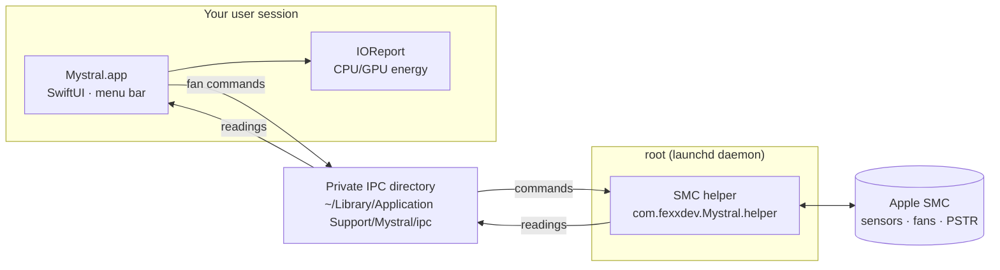

<div align="center">


# Mystral

**Fan curves, temperatures and power draw for Apple Silicon Macs, from the menu bar.**

[](https://github.com/fexxdev/Mystral/releases/latest) [](https://github.com/fexxdev/Mystral/actions/workflows/ci.yml)    [](LICENSE)

<a href="https://macpip.com/apps/mystral?ref=badge"></a>

[**Download**](https://github.com/fexxdev/Mystral/releases/latest) · [Features](#features) · [Install](#installation) · [Usage](#usage) · [How it works](#how-it-works) · [FAQ](#troubleshooting)

<br>


</div>

## Why Mystral

macOS keeps Apple Silicon fans quiet until the chip is already hot. Mystral lets you decide: draw your own fan curve, switch it automatically when you plug in or open a heavy app, and watch temperatures and watts live. It is a native SwiftUI app, has no kernel extension and sends no telemetry.

## Features

### 🌀 Fan control
- **Real fan control on Apple Silicon.** Mystral unlocks manual mode through the SMC `Ftst` key, so `thermalmonitord` stops overriding your speeds.
- **Curve editor**: drag points on the chart or type values into the table next to it. Use one curve for all fans, or a separate curve per fan.
- **Driving sensor**: base a curve on the CPU average or on any single sensor.
- **Manual override**: pin a fan to a fixed speed from the Fans view.
- **Smooth, quiet behaviour**: EMA smoothing on the input temperature, a deadband that skips tiny speed changes, and an optional minimum fan speed.
- **Aggressive re-assert**: keeps re-applying forced mode in case the SMC firmware takes control back.
- **Quiet sleep**: before the Mac sleeps, fans go back to macOS automatic control. Your curve takes over again on wake.

### 📊 Monitoring
- **Dashboard** with CPU and GPU max/average, a CPU summary (die, package, hotspot), per-core grids and a 5-minute history chart.
- **Sensors** view listing every SMC temperature sensor. You can search, sort, filter by category (CPU, GPU, SoC, memory, SSD, battery, airflow, board, power delivery) and see a sparkline trend for each.
- **Fans** view with current, target and min–max RPM, and whether macOS or Mystral is driving each fan.
- **Chip detection** for your exact chip, its real core counts (performance, efficiency and super cores) and how well its sensors are supported.
- **Sensor layouts for M1 to M6**, checked against load-test recordings of twelve Macs: a sensor is listed as CPU or GPU only if it warms under that load.

### ⚡ Power
- **Total system watts** from the SMC (`PSTR`), plus **CPU and GPU watts** from the IOReport energy model. No extra permissions needed.
- A stacked **CPU / GPU / Other** bar and a **Power — Last 5 Minutes** chart on the Dashboard.
- Watts in the menu bar and in the live dropdown.

### 🎛 Profiles and automation
- **4 presets** (Silent, Balanced, Performance, Full Blast) and up to **10 custom profiles**. You can rename, duplicate and delete custom ones.
- **Auto-switch triggers**: activate a profile when you plug in or switch to battery, when the system thermal state changes (Nominal, Fair, Serious, Critical), or when a given app comes to the front.
  Frontmost-app triggers win over thermal-state triggers, which win over power-source triggers. Turn this on in **Settings → Auto-Switch**.

### 🔝 Menu bar
- **Display modes**: icon only, temperature, RPM, active profile, power, or a live mini-graph, each with or without the icon.
- **Temperature source** for the menu bar: CPU average, CPU max, GPU average, GPU max, or the hottest sensor.
- **Live dropdown** with CPU and GPU temperatures, power, every fan's RPM and one-click profile switching. It keeps updating while it is open.

### 🔔 Alerts and diagnostics
- Notifications for **high CPU temperature** (threshold you choose) and for **fans that stop responding**.
- A **30-second stress test** that loads every core and checks that your fans actually react.
- **SMC export** for the developer, which helps add support for new chips.

### 🛡 Reliable and safe
- The SMC helper runs as a **launchd daemon**. It survives sleep and reboots, and it restarts itself if it dies. If it stops responding, the Dashboard shows a banner with a **Restart Helper** button.
- **Signed in-app updates**: Mystral installs an update automatically only when its Ed25519 signature matches the release key built into the app.
- Hardened runtime, a root-owned app bundle, and a private IPC directory between the app and the helper.

### 🌍 Languages
English, Italiano and 简体中文. Mystral follows your macOS language, or pick one in **Settings → General → Language**; Mystral offers to restart and reopens on Settings. [Help translate it](CONTRIBUTING.md#translations).

## Screenshots

<table>
  <tr>
    <td width="50%"><p align="center"><b>Sensors</b>: every SMC sensor, filterable and sortable</p></td>
    <td width="50%"><p align="center"><b>Fans</b>: live RPM and manual override</p></td>
  </tr>
  <tr>
    <td width="50%"><p align="center"><b>Profiles</b>: presets, custom curves, per-fan overrides</p></td>
    <td width="50%"><p align="center"><b>Settings</b>: chip detection, menu bar, fan behaviour</p></td>
  </tr>
</table>

## Requirements

| | |
|---|---|
| **macOS** | 14 Sonoma or later |
| **Mac** | Apple Silicon, M1 through M6 |
| **Permissions** | One administrator password to install the fan helper |

### Verified on real hardware

Mystral is confirmed working on these Macs, by running it on them:

| Mac | macOS | Verified |
|---|---|---|
| **M3 Pro** MacBook Pro (`Mac15,6`) | 27 | Fan control, sensor layout, power readings |
| **M4 Pro** (`Mac16,11`) | 15.7 | Fan control, sensor layout. Needs Mystral 1.1.9 or later ([#8](https://github.com/fexxdev/Mystral/issues/8)) |

On every other chip from M1 to M6 the sensor layout is checked against load recordings and other open-source monitors, not on the Mac itself. If Mystral works on yours, or does not, an [issue](https://github.com/fexxdev/Mystral/issues/new/choose) with the SMC export gets it added here.

> [!NOTE]
> Mystral takes manual control of the fans by unlocking the SMC `Ftst` key. **Settings → Chip Detection → Fan control** shows **Working** while Mystral is driving the fans. If it says **Not available** on your Mac, please [open an issue](https://github.com/fexxdev/Mystral/issues/new/choose) with the SMC export from **Settings → Diagnostics**.

## Installation

1. Download the latest **`Mystral-x.x.x.dmg`** from [Releases](https://github.com/fexxdev/Mystral/releases/latest).
2. Open it and drag **Mystral.app** into **Applications**.
3. Launch Mystral. If macOS says it can't verify the developer (ad-hoc builds), right-click **Mystral.app** → **Open** → **Open**.
4. Enter your administrator password once. Mystral installs its fan helper as a launchd daemon and makes the app bundle root-owned, so no other program can swap the binary the helper runs.

Mystral now sits in the menu bar. Your profiles are saved in `~/Library/Application Support/Mystral/profiles`.

### Updates

**Settings → Updates** checks GitHub Releases, at most once a day when automatic checks are on, or right away with **Check Now**. When a release ships with a valid `.sig` signature, **Install Update** downloads it, verifies it, replaces the app and relaunches; it asks for your administrator password because the app is root-owned. A release without a valid signature only opens its release page.

## Usage

**Click the fan icon** in the menu bar (left or right click) to open the live dropdown: temperatures, power, fan speeds and your profiles. Choose **Open Mystral** (`⌘O`) for the full window. Mystral shows a Dock icon only while that window is open.

| Section | What you do there |
|---|---|
| **Dashboard** | Temperatures, CPU/GPU core grids, power breakdown, history charts, active profile |
| **Sensors** | Browse, search, sort and filter every temperature sensor |
| **Fans** | Live RPM per fan, manual override |
| **Profiles** | Pick a preset, create custom curves, set per-fan curves and auto-switch triggers |
| **Settings** | Launch at login, language, menu bar display, polling interval (2/5/10 s), fan behaviour, alerts, updates, diagnostics |

### Preset profiles

| Profile | Curve | Good for |
|---|---|---|
| 🔇 **Silent** | 10% at 30 °C → 80% at 95 °C | Quiet work; temperatures can run higher |
| ⚖️ **Balanced** *(default)* | 15% at 30 °C → 100% at 95 °C | Everyday use, close to Apple's behaviour |
| 🐇 **Performance** | 25% at 30 °C → 100% at 85 °C | Builds, renders, games |
| 🌪 **Full Blast** | 100% at any temperature | Maximum cooling |

Presets are read-only. **Duplicate as Custom** gives you an editable copy.

## How it works



- Writing fan speeds to the SMC needs root, so a small helper runs as a **launchd daemon** at `/Library/PrivilegedHelperTools/com.fexxdev.Mystral.helper`. It publishes sensor and fan readings and applies the fan commands the app sends.
- App and helper share a user-owned directory with `0700` permissions. The helper opens every file in it without following symlinks, checks ownership, and validates every command (fan index, percentage and mode ranges) before acting on it.
- On every polling tick the app reads temperatures, smooths them, interpolates the active curve and sends new target speeds when the change is larger than the deadband.
- Before the Mac sleeps, the helper hands the fans back to macOS automatic mode. After wake, the app re-applies your curve.

## Troubleshooting

<details>
<summary><b>The Dashboard says the SMC helper is not responding</b></summary>

Click **Restart Helper** in the banner. Mystral also retries by itself and, if that fails, tries again every 12 hours. To see what happened:

```bash
log show --last 1h --predicate 'subsystem == "com.fexxdev.Mystral"'
```
</details>

<details>
<summary><b>My fans don't change speed</b></summary>

- Check **Settings → Chip Detection → Fan control**. **Working** means the fans are in forced mode under Mystral. **Not available** means the SMC kept them in automatic mode: please [report it](https://github.com/fexxdev/Mystral/issues/new/choose) with the SMC export.
- Make sure **Aggressively re-assert manual control** is on in **Settings → Fan Behavior**.
- Run the **30s stress test** in **Settings → Diagnostics** to check whether the fans react.
</details>

<details>
<summary><b>My chip or some sensors aren't recognised</b></summary>

Use **Settings → Diagnostics → Export SMC Data for Developer** and attach the file to a [bug report](https://github.com/fexxdev/Mystral/issues/new/choose).
</details>

<details>
<summary><b>Why does an update ask for my password?</b></summary>

The app bundle is owned by root, so only an administrator can replace it. That stops other software running as your user from tampering with the program the root helper runs.
</details>

## Uninstall

Quit Mystral from its menu (**Quit**, `⌘Q`) first: that hands the fans back to macOS automatic control. Then run:

```bash
sudo launchctl bootout system/com.fexxdev.Mystral.helper
sudo rm -f /Library/LaunchDaemons/com.fexxdev.Mystral.helper.plist
sudo rm -f /Library/PrivilegedHelperTools/com.fexxdev.Mystral.helper
sudo rm -rf /Applications/Mystral.app
rm -rf ~/Library/Application\ Support/Mystral
defaults delete com.fexxdev.Mystral
```

## Build from source

```bash
brew install xcodegen
git clone https://github.com/fexxdev/Mystral.git
cd Mystral
xcodegen generate
open Mystral.xcodeproj            # develop and run
./scripts/build-dmg.sh            # Release DMG + update signature in dist/
```

For a Developer ID build, set `MYSTRAL_SIGNING_IDENTITY="Developer ID Application: Your Name (TEAMID)"`. `build-dmg.sh` also writes `Mystral-x.x.x.dmg.sig` with the Ed25519 release key from your Keychain (`scripts/update-key.sh`). Forks must generate their own key and replace `UpdateSignature.publicKeyBase64`.

See [CONTRIBUTING.md](CONTRIBUTING.md) for tests, the release process and translations, and [docs/ARCHITECTURE.md](docs/ARCHITECTURE.md) for how the app, the helper and the sensor rules work in detail.

## Privacy

Mystral collects no telemetry or usage data. Its only network request is the GitHub Releases check, and only when update checks are on.

## Credits

Built by [@fexxdev](https://github.com/fexxdev). Simplified Chinese translation by [@huangyixin447](https://github.com/huangyixin447).

## License

MIT. See [LICENSE](LICENSE).
