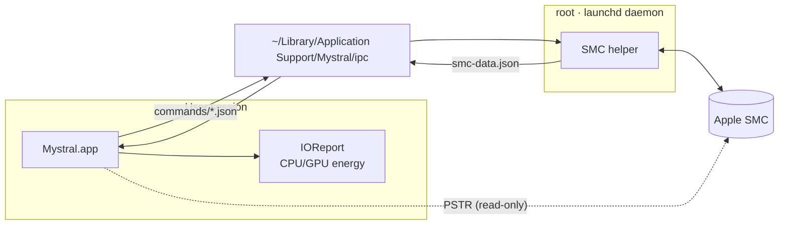

# Mystral architecture

How Mystral works today. The dated documents in `docs/superpowers/` are the design specs and plans written before each feature; where they differ from this file, this file and the code are right.

## Overview

Mystral is one binary that runs as two processes.

| Process | Runs as | Started by | Does |
|---|---|---|---|
| **App** (`Mystral.app`) | the user | the user, or login items | UI, fan curves, power readings, alerts, updates |
| **Helper** (same binary with `--smc-helper`) | root | launchd (`com.fexxdev.Mystral.helper`) | reads sensors and fans from the SMC, writes fan speeds |

Writing fan speeds to the SMC needs root. Everything else runs as the user. The two processes share a private directory and talk through files in it.

Source layout:

| Path | Contents |
|---|---|
| `Mystral/main.swift` | Entry point: helper mode or the app |
| `Mystral/App` | `AppDelegate` (startup, helper install, window), `MystralApp` |
| `Mystral/MenuBar` | Status item, display modes, live dropdown |
| `Mystral/Views` | Dashboard, Sensors, Fans, Profiles, curve editor, Settings |
| `Mystral/Services` | Everything below the UI (see the sections that follow) |
| `Mystral/Models` | `Profile`, `CurvePoint`, `Fan`, `Sensor` |
| `Mystral/Presets` | The four built-in profiles (JSON) |
| `Mystral/Localizable.xcstrings` | Every UI string, in English, Italian and Simplified Chinese |

## Startup

`AppDelegate.applicationDidFinishLaunching`:

1. Takes an activity assertion so App Nap does not slow the timers.
2. Creates `ProfileManager` (presets from the bundle, custom profiles from disk).
3. Prepares the IPC directory and creates `SMCProxyService`, then checks the helper (`ensureHelperInstalled`). If the daemon is missing or out of date it installs it, which asks for an administrator password.
4. Creates `FanController`, applies saved settings, then `ProfileAutoSwitcher`, `AlertManager`, `MenuBarManager` and `UpdateChecker`.
5. Starts the polling loop.

With `--open-settings` the main window opens on Settings (used after a language change).

## The helper

Installed by the app as a launchd daemon:

- Binary: `/Library/PrivilegedHelperTools/com.fexxdev.Mystral.helper`, a root-owned copy of the app's executable.
- Plist: `/Library/LaunchDaemons/com.fexxdev.Mystral.helper.plist`, `KeepAlive`, with the IPC directory, the user's uid, the app version and the build number in its environment.
- The app considers the helper current only when the plist matches the running app: executable path, IPC directory, uid, version and **build number** (`CFBundleVersion`). A new build number therefore reinstalls the helper, and nothing else does.
- The app bundle in `/Applications` is made root-owned, so no other program running as the user can replace the binary the helper is copied from.

Every 2 seconds (`SMCHelperMode.tickInterval`) the helper:

1. Opens the IPC directory and checks its owner and mode. Files are opened through directory descriptors with `O_NOFOLLOW`.
2. Reads and deletes the command files, ignoring any over 4 KB or failing validation.
3. Hands the fans back to macOS if no heartbeat arrived for 8 seconds (`heartbeatTimeout`).
4. Reads every temperature and fan from the SMC and writes `smc-data.json` atomically.

After three failed SMC reads in a row it also restores automatic control. Before the Mac sleeps it restores automatic control so fans do not stay pinned at the last speed.

### IPC files

In `~/Library/Application Support/Mystral/ipc` (mode `0700`, owned by the user):

| File | Written by | Contents |
|---|---|---|
| `smc-data.json` | helper | `version`, `sensors` (`key`, `name`, `temperature`), `fans` (`id`, `name`, `currentRPM`, `targetRPM`, `minRPM`, `maxRPM`, `mode`) |
| `commands/*.json` | app | one command each |
| `helper.pid` | helper | its pid |
| `diagnostics.log` | helper | SMC key dump written at start |

Commands (`SMCHelperMode.Command`):

| `action` | `index` | `value` |
|---|---|---|
| `heartbeat` | 0 | none |
| `setFanSpeed` | fan 0–7 | percent 0–100 |
| `setFanMode` | fan 0–7 | 0 automatic, 1 forced |
| `setForcedMode` | fan count 1–8 | 0 or 1 |
| `restart` | 0 | none (the helper exits; launchd restarts it) |

The app treats the helper as unresponsive when `smc-data.json` is more than 10 seconds old, with grace periods after launch and after wake. It then shows a banner, retries the install up to three times, and tries again every 12 hours.

## The polling loop

`FanController.tick()` runs every polling interval (2, 5 or 10 seconds):

1. `PowerMonitor.sample` reads power.
2. Reads sensors and fans from the helper's data and carries each sensor's history forward.
3. Sends a heartbeat.
4. Re-asserts forced mode when needed: once after start or wake, and every fifth tick while "Aggressively re-assert manual control" is on.
5. Resolves the driving temperature, smooths it (EMA, default α 0.3), interpolates the active profile's curve, applies the minimum fan speed, and writes a new speed only when it differs from the last written one by more than the deadband (default 3%).
6. Evaluates alerts.

Because the helper times out after 8 seconds, polling intervals above 3 seconds also run a separate heartbeat every 3 seconds (`FanController.heartbeatPeriod`).

Manual override from the Fans view replaces the curve's output for that fan. Quitting the app sends the un-force command, so fans return to macOS control.

### Fan control

`SMCService` writes the `Ftst` key to unlock manual mode, sets each fan's mode key (`F<n>Md`) to forced and writes target speeds (`F<n>Tg`). **Settings → Chip Detection → Fan control** shows Working only while a fan actually reports forced mode.

Fan control is verified on an M3 Pro MacBook Pro (macOS 27). It is not verified on other chips.

### The driving temperature

A profile either names a sensor key or uses the default. The default is the hottest point of the CPU (`SensorRegistry.defaultDrivingTemperature`): the highest of the `TCMz` key and the CPU cluster sensors. Where `TCMz` exists (M1–M4) the two normally agree; M5 and M6 publish no `TCMz`. `TCMz` alone is not steady on M4 Pro/Max: it is the maximum over the keys live at that instant, so it drops by 15–20 °C for a tick when the performance cores switch off.

## Sensors

Apple documents no SMC temperature key, and a key can mean different things on different chips. `SensorRegistry.classify(_:chip:)` gives each key a name and a category from prefix rules and a short table of keys that mean the same everywhere.

- `HardwareInfo.chip` describes the Mac: family (1–6 for M1–M6, nil otherwise), tier (base, Pro, Max, Ultra) and the names of the CPU core levels the kernel reports.
- Categories: CPU, CPU Summary, GPU, SoC, Memory, SSD, Battery, Airflow, Board, VRM, Other.
- No key is named after one core. Each cluster publishes groups of probes, aggregates and maxima.
- A key no rule knows keeps its key as name, and the SMC export marks it `UNMAPPED`.

Main rules:

| Keys | Meaning |
|---|---|
| `Tp…` | CPU clusters. On M1 `Tp09`/`Tp0T` are the efficiency cluster and `TpD…` is power delivery |
| `Te…` | Efficiency cluster (CPU die on M1) |
| `Tm…` | Memory; on M5 Pro/Max the performance cluster |
| `Tg…` | GPU |
| `Tf…`, `Th…`, `Ts…` (not ending in `P`), `TUD…`, `Ta0x` on M5/M6 | SoC: warm with CPU or GPU load |
| `Ts…P`, `TS…P`, `TH…` | SSD |
| `TB…T`, `TG…` | Battery |
| `TD…`, `TT…`, `TI…`, `TW…` | Board |
| `TPD…`, `TRD…`, `TV` + digit | Power delivery and voltage probes |
| `TVD…`, `TVA…`, `TVM…`, `TVS…` | Values the SMC models rather than measures |

A reading is used only if the key's SMC type is `flt` or `sp78` and the value is between 10 and 130 °C. The CPU average and maximum cover every CPU cluster sensor except readings of exactly 40.0 °C, which M4 Pro/Max report for their parked key bank.

How the rules were checked, and what is not checked, is in the comment on `classify` and in `THIRD-PARTY-NOTICES.md`: load tests on an M3 Pro, and the load recordings published by iSMC for M1 Ultra, M3, M3 Pro/Max, M4, M4 Pro/Max, M5, M5 Pro/Max and M6. There is no recording for the A18 Pro.

Histories: `SensorHistoryStore` keeps one value per tick per sensor, repeating the last value for up to five missed ticks, so all series stay aligned in time. `SensorRegistry.alignedHistory` combines them aligned on the newest sample.

### CPU keys that switch off

An M4 Pro publishes two banks of 51 performance-cluster keys. Under heavy load both are live; under light load one is, and they take turns; when the cores idle both are off for a second or two. A bank that is off reads exactly 40.0 °C or a few degrees around zero. Without care the CPU goes from 61 sensors to 10 and back between ticks.

`SensorHistoryStore` therefore holds a CPU cluster key that just went off at its last live reading (`Sensor.isHeld`) for about 10 seconds (`cpuHoldTicks`). It only fills a gap: it shows as many keys as were live at once during those 10 seconds, never more, so when the other bank takes over nothing is held. The count comes from live keys only. Counting held keys too made it latch: on an M4 Pro the banks take turns every 2–6 s, faster than a hold expires, so once both had been live the count stayed at both banks (96 instead of 51 for ten minutes in the trace attached to issue #8). Held sensors count in the CPU average, the maximum and the default driving temperature, and the Dashboard draws them dimmed. Stats and smctemp do the same thing without a time limit; macmon and mactop average whatever is valid at that instant.

`Tpx…` and `Tex…` (M4) are per-die aggregates, half of them exact copies of a group maximum. They are CPU summary values, not cluster sensors. The Dashboard summary box shows only `TCMz`, `TCMb` and `TCDX`.

`SensorTrace` records one entry per tick for the last 300 ticks: how many CPU cluster keys the helper delivered live and parked, how many are held, `TCMz` as read, the default driving temperature, what the curve was given and the fan speeds. It lives in memory in `FanController` and is appended to the SMC export (Settings → Diagnostics), so a user with a Mac we do not own can show what its keys do.

### Core counts

`HardwareInfo.coreCounts` reads `hw.nperflevels`, each level's `hw.perflevelN.name` and `physicalcpu`, `hw.physicalcpu`, and `gpu-core-count` from the `AGXAccelerator` registry entry. Levels differ by chip: Performance + Efficiency up to M4, Super + Efficiency on M5, Super + Performance on M5 Pro/Max, all three on M6.

## Power

`PowerMonitor` samples once per tick, in the app, without root:

- **Total system power**: SMC key `PSTR`. Values above 1,500 W are ignored.
- **CPU and GPU power**: IOReport energy counters (`IOReportPower`), as energy difference over time.
  - On macOS 27 the "Energy Model" CPU counter stops for long stretches, so Mystral subscribes to the AppleCLPC energy counters instead. Their report IDs are per driver and per macOS major; the table in `CLPCEnergyChannels` covers 17 drivers (M1 to M6 and A18 Pro) for macOS 27 and is ported from macmon.
  - On other macOS versions, or with a driver not in the table, it uses the Energy Model channels "CPU Energy" and "GPU Energy" (per-die `DIE_n_…` channels on Ultra chips).
- Windows are timed with a clock that keeps running during sleep, and never shorter than half the polling interval. A reading that is negative, above 500 W, or above 10× the system total + 100 W is dropped. A CPU counter that did not move is "no reading", held for 6 seconds, then shown as unavailable.
- Histories store nil for a tick without a reading.

## Profiles and automation

- A `Profile` has a curve (points of temperature → fan %), an optional driving sensor key, optional per-fan curves and optional triggers.
- Presets are read-only JSON in the bundle. Custom profiles (up to 10) are JSON files in `~/Library/Application Support/Mystral/profiles`.
- `ProfileAutoSwitcher` activates the profile whose trigger matches. Frontmost app beats thermal state, which beats power source.

## Alerts

`AlertManager` sends a notification when the hottest CPU sensor passes the threshold, and when a fan reads under 100 RPM while its target is above 30%. Each alert has a 60-second cooldown.

## Updates

`UpdateChecker` asks the GitHub Releases API for the latest release, at most once a day when automatic checks are on.

A release installs itself only if it has a DMG **and** a `.sig` next to it, and the Ed25519 signature verifies against `UpdateSignature.publicKeyBase64`. The updater then mounts the DMG, checks the bundle identifier, package type, version and code signature, replaces the app with administrator rights, and relaunches through `AppRelauncher`. Without a valid signature it only opens the release page.

## Localization

- `Localizable.xcstrings` is the only string store. XcodeGen adds each language in it to the project.
- `AppLanguage` lets the user override the language. It writes the app's own `AppleLanguages` preference, the same one System Settings uses for per-app languages. macOS applies it at launch, so the app offers to restart.
- Sensor names are English and not translated. Category names are.

## Settings storage

`UserDefaults` domain `com.fexxdev.Mystral`:

| Keys | Meaning |
|---|---|
| `menuBarDisplayMode`, `menuBarTempSource` | Menu bar |
| `pollingInterval` | 2, 5 or 10 seconds |
| `smoothingEnabled`, `smoothingAlpha`, `deadbandPercent`, `minimumFanPercentage`, `aggressiveOverrideEnabled` | Fan behaviour |
| `alertsEnabled`, `alertsHighTempThreshold`, `alertsFanStuckEnabled` | Alerts |
| `autoSwitchEnabled` | Profile triggers |
| `updatesAutoCheckEnabled`, `updatesLastCheckedAt` | Updates |
| `dashboardCpuSensorsExpanded`, `dashboardGpuSensorsExpanded` | Dashboard grids |
| `AppleLanguages` | Language override (not cleared by Reset All Settings) |

"Reset All Settings" clears the keys in `AppSettings.resettableKeys`.

## Files on disk

| Path | What |
|---|---|
| `/Applications/Mystral.app` | The app, root-owned |
| `/Library/PrivilegedHelperTools/com.fexxdev.Mystral.helper` | Helper binary |
| `/Library/LaunchDaemons/com.fexxdev.Mystral.helper.plist` | Helper daemon definition |
| `~/Library/Application Support/Mystral/profiles` | Custom profiles |
| `~/Library/Application Support/Mystral/ipc` | App ↔ helper files |

Logs go to the unified log under subsystem `com.fexxdev.Mystral`.

## Tests and CI

Unit tests in `MystralTests` cover curve interpolation, the sensor rules per chip, power evaluation, the helper protocol and install checks, profiles, updates and signatures, localization and settings. Views are only constructed, not rendered.

CI (`.github/workflows/ci.yml`, Xcode 16.4 on macOS 15) regenerates the project and fails on a diff, lints metadata and scripts, builds Debug and Release, runs the tests and requires 10% line coverage.
